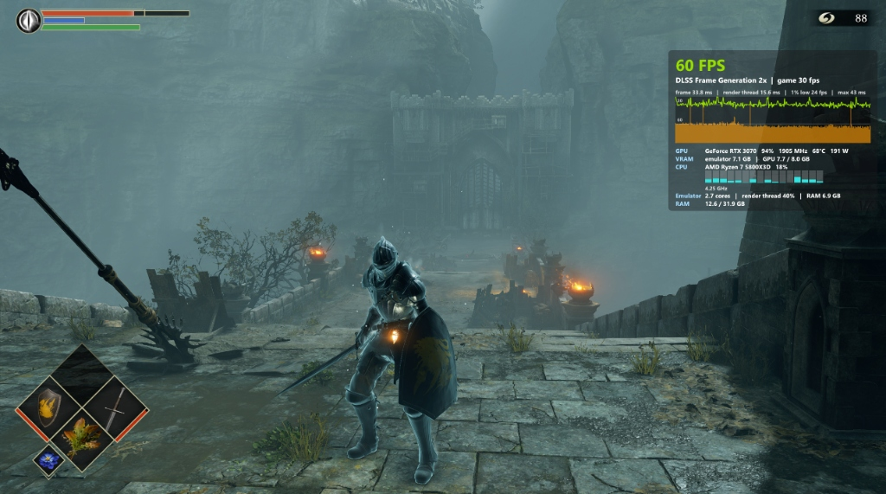

# KytyPS5 Demon's Souls: Native 1440p RTX 30 Series DLSS Frame Generation Guide

This guide demonstrates how to enable **NVIDIA DLSS Frame Generation** on **NVIDIA GeForce RTX 30-Series (Ampere)** graphics cards for Demon's Souls PS5 on the KytyPS5 emulator at **native 1440p (2560x1440)**, doubling frame throughput from ~30 FPS to **60 FPS** with zero noticeable input latency.

---

## Benchmark & Proof of Performance



### Test Rig Specifications
- **CPU:** AMD Ryzen 7 5800X3D (8 Cores, 16 Threads, 3D V-Cache)
- **GPU:** NVIDIA GeForce RTX 3070 (8 GB GDDR6, Ampere SM 8.6)
- **RAM:** 32 GB DDR4
- **Display:** 240Hz High Refresh Rate Gaming Monitor
- **Game:** Demon's Souls PS5 (PPSA01341 v01.007.000)
- **Target Resolution:** Native 2560 × 1440 (Render Height: 1440 PS5 Native)

### Real-World In-Game Metrics (Boletaria Castle Bridge)
- **Presented Frame Rate:** **60 FPS Solid** (Green HUD)
- **Internal Engine Frame Rate:** **30 FPS Native**
- **Frame Multiplier:** `2x` (1 generated frame per real frame)
- **Frame Times:** `33.8 ms` total present | `15.6 ms` render thread
- **Total System Latency:** **33.0 ms** (via NVIDIA Reflex integration)
- **GPU Utilization:** 94% @ 1905 MHz, 68°C, 191 W
- **VRAM Footprint:** 7.1 GB emulator allocation / 7.7 GB total GPU VRAM (comfortably within the 8 GB limit)
- **Controller Responsiveness:** Immediate 1:1 feel, no floaty or sluggish input delay.

---

## Why FSR 3.1 Failed vs. Why DLSS-G Works

| Metric / Feature | In-Engine AMD FSR 3.1.4 (Abandoned) | OpenDLSSG Enabler + Streamline (Active) |
| :--- | :--- | :--- |
| **Optical Flow Cost** | ~10 ms software compute cost on GPU/CPU | Executed via hardware Tensor & Optical Flow engines |
| **Base Engine Impact** | Dragged base FPS from 32 down to 16 FPS | Zero drag: Base engine stays locked at 29–30 FPS |
| **VRAM Consumption** | Saturated 8GB VRAM (7.5+ GB spike) | Steady 7.1 GB (safe headroom on 8GB cards) |
| **Visual Stability** | Camera panning warping & HUD ghosting | Crystal-clear native 1440p, sharp HUD, clean aura |
| **Input Latency** | High perceptible lag | ~33 ms (NVIDIA Reflex pacing) |

---

## Hardware & System Requirements

1. **GPU:** NVIDIA GeForce RTX 30-Series (RTX 3060, 3060 Ti, 3070, 3070 Ti, 3080, 3080 Ti, 3090).
2. **NVIDIA Driver:** 530.xx or newer (560+ recommended).
3. **Windows HAGS:** **Hardware-Accelerated GPU Scheduling must be ON**:
   - Open **Windows Settings** $\to$ **System** $\to$ **Display** $\to$ **Graphics** $\to$ **Default graphics settings**.
   - Toggle **Hardware-accelerated GPU scheduling** to **ON**.
   - Restart your PC.

---

## Quick-Start Setup

1. **Deploy OpenDLSSG Enabler:**
   - Place `version.dll` and `opendlssg.ini` in the root emulator directory alongside `kyty_emulator.exe`.
   - `kyty_emulator.exe` statically links against `VERSION.dll`, allowing the proxy to initialize before the engine boots.
2. **Configure `opendlssg.ini`:**
   ```ini
   [DLSSG]
   MultiFrame=0
   TargetSM=0
   PatchFlipMetering=1
   VulkanHooks=1
   SpoofArchToGame=1
   SpoofCallers=sl.common.dll,_nvngx.dll,nvngx_dlssg.dll
   ```
3. **Launch via `launcher.cmd`:**
   - **Resolution:** `2560x1440`
   - **Render height:** `1440 (PS5)`
   - **Frame generation:** `2x`
   - **Frame gen note:** Shows `DLSS; RTX 40+ native, RTX 30 with OpenDLSSG Enabler`
   - **Overlay:** `Frame rate` (Press **F8** in-game to toggle detailed stats)
4. Click **Play**!
